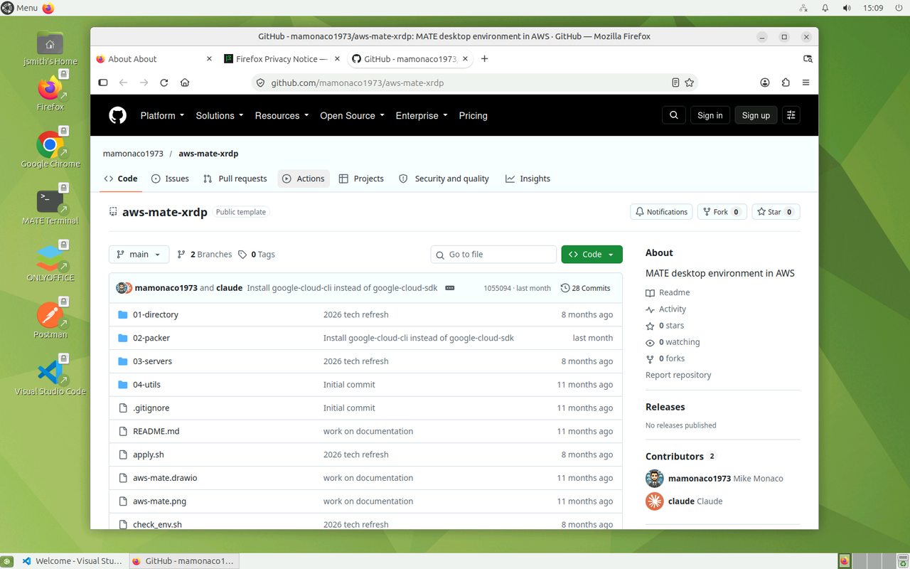
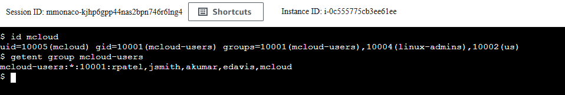
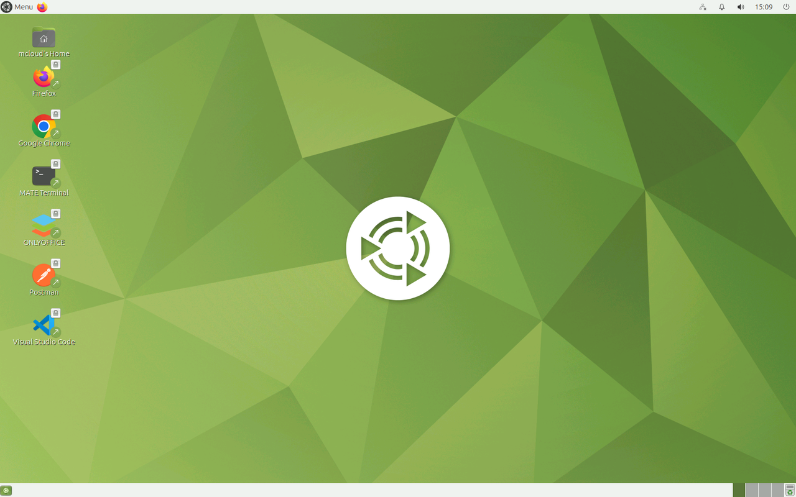

# MATE XRDP Desktop + Active Directory on AWS

A cloud Linux workstation for every build on the channel. A **MATE** desktop
on **Ubuntu 26.04 LTS**, reached over RDP (XRDP), joined to a **mini-AD**
domain, with home directories on **Amazon EFS**. Users sign in with their AD
account, and their files follow them to any desktop built from the same AMI.



| Piece | Where | Role |
|---|---|---|
| **MATE desktop** | public subnet | Packer-built AMI (MATE + XRDP + dev tools); joined to AD with SSSD at boot; RDP and SSH from the internet |
| **Windows Server 2022** | public subnet | joined to AD; RSAT for managing users; maps the desktop's `/efs` share as `Z:` |
| **mini-AD** (Samba DC) | private subnet | users, groups, POSIX IDs, DNS, Kerberos |
| **Amazon EFS** | both subnets | `/home` and the shared `/efs` area, mounted over NFS with TLS |
| **Secrets Manager** | regional | AD admin and user passwords |
| **NAT gateway** | public subnet | outbound internet for the DC's private subnet |

## Architecture

<picture>
  <source media="(prefers-color-scheme: dark)" srcset="architecture-dark.svg">
  
</picture>

Regenerate with `python3 make_diagram.py`.

- **`01-directory/`**: the VPC (`mate-vpc`, 10.0.0.0/24), a public VM subnet,
  a private DC subnet, the NAT gateway, and the
  [`module-aws-mini-ad`](https://github.com/mamonaco1973/module-aws-mini-ad)
  Samba DC with users and POSIX attributes from `users.json`. DHCP points VPC
  DNS at the DC.
- **`02-packer/`**: builds the MATE AMI from Canonical's Ubuntu 26.04 image:
  `ubuntu-mate-desktop`, XRDP with a MATE session, the SSSD, realmd and Samba
  packages, `amazon-efs-utils`, and the channel's tool set (Chrome, Firefox,
  VS Code, Docker, Packer, Terraform, AWS/Azure/Google Cloud CLIs, Postman,
  KRDC, OnlyOffice). The domain join is left to boot time, because a computer
  account and keytab can't be baked into a shared image.
- **`03-servers/`**: EFS and its mount targets, the MATE desktop and Windows
  hosts, their IAM role and security groups.

## What's in the image

- **Snap is left as Ubuntu ships it.** Firefox and the SSM agent are snaps.
  Chrome, VS Code, Postman and OnlyOffice come from `.deb` packages.
- **Snaps work in an XRDP session** because `/etc/xrdp/startwm.sh` exports
  `XAUTHORITY`. XRDP starts Xorg with `-auth .Xauthority` but doesn't export
  the variable; snaps run with a redirected `$HOME`, so without it they fail
  with "Authorization required".
- **No polkit prompts in RDP sessions.** A polkit rule allows colour-profile
  and package-refresh actions that otherwise ask for a password at login.
- **New users get the desktop icons and defaults** from `/etc/skel`.

## How sign-in works

1. At boot the desktop mounts EFS (`/efs`, and `/home` from `/efs/home`),
   reads the AD admin password from Secrets Manager, and joins the domain with
   `realm join`. SSSD is set for short names (`jsmith`, not
   `jsmith@mcloud.mikecloud.com`) and the POSIX IDs stored in AD.
2. An RDP client connects to the desktop's public address on 3389. XRDP
   checks the password through PAM and SSSD, creates the home directory on
   EFS on first login, and starts MATE.
3. Members of **`linux-admins`** (jsmith and rpatel) get passwordless sudo.
4. The Windows host joins the same domain and maps the desktop's Samba share
   of `/efs` as `Z:`, which holds this repository and the helper scripts.

| User | Groups | sudo on the desktop |
|---|---|---|
| jsmith | mcloud-users, us, linux-admins | yes |
| edavis | mcloud-users, us | no |
| rpatel | mcloud-users, india, linux-admins | yes |
| akumar | mcloud-users, india | no |

## Security groups

```
internet ─3389, 22, 445─▶ MATE desktop ─2049─▶ EFS
internet ─3389─────────▶ Windows ─445─▶ MATE desktop (Z: is /efs)
```

Both hosts are open to `0.0.0.0/0` on their ports; every login still needs
an AD account. The DC has no public address. Admin access to both hosts is
also available through **SSM Session Manager**.

## Prerequisites

* [An AWS Account](https://aws.amazon.com/console/)
* [Install AWS CLI](https://docs.aws.amazon.com/cli/latest/userguide/getting-started-install.html)
* [Install Terraform](https://developer.hashicorp.com/terraform/install)
* [Install Packer](https://developer.hashicorp.com/packer/install)
* [Install jq](https://jqlang.github.io/jq/download/)

If this is your first time watching our content, we recommend starting with
this video: [AWS + Terraform: Easy Setup](https://youtu.be/BCMQo0CB9wk).

## Deploy

```bash
git clone https://github.com/mamonaco1973/aws-mate-xrdp.git
cd aws-mate-xrdp
./apply.sh       # 1: VPC + mini-AD  2: MATE AMI (Packer)  3: EFS, desktop, Windows
```

BUILD_TIMINGS

`apply.sh` ends by running `validate.sh`, which prints the two hosts:

```
===============================================================================
VALIDATION RESULTS: AD + MATE DESKTOP
===============================================================================

Windows AD Admin Host:       ec2-203-0-113-10.compute-1.amazonaws.com
MATE Desktop Host:           ec2-203-0-113-20.compute-1.amazonaws.com

===============================================================================
```

## Try it

1. Get a user's password from Secrets Manager:

   ```bash
   aws secretsmanager get-secret-value --secret-id jsmith_ad_credentials_mate \
     --query SecretString --output text | jq -r .password
   ```

2. RDP to the **MATE Desktop Host** as `jsmith`. The MATE desktop opens, and
   jsmith's home directory is created on EFS on first login. Try `id`,
   `getent group linux-admins`, `sudo -l` and `df -h /home`.
3. Sign out and sign in as `edavis`: the same desktop, no sudo.
4. RDP to the **Windows AD Admin Host** as `MCLOUD\jsmith`. **Active Directory
   Users and Computers** is installed, and `Z:` is the desktop's `/efs`.

### Add a desktop user

1. On the Windows host, open **Active Directory Users and Computers** and turn
   on **View > Advanced Features**.
2. Under the **Users** container of `mcloud.mikecloud.com`, create the user
   (for example `mcloud`) and set a password.

   

3. Get the next free `uidNumber`: run `Z:\aws-mate-xrdp\04-utils\getNextUID.bat`.
4. In the user's **Attribute Editor**, set `uidNumber` to that value,
   `gidNumber` to `10001` (`mcloud-users`), and `uid` to the login name.
5. On **Member Of**, add `mcloud-users` (and `linux-admins` for sudo).
6. On the desktop (SSM or SSH), `id mcloud` shows the new IDs and groups.

   

7. RDP to the desktop as the new user.

   

## Troubleshooting

| Symptom | Fix |
|---|---|
| RDP rejects every AD password | The desktop hasn't finished its domain join. `aws ssm start-session --target <instance-id>`, then `sudo cat /root/userdata.log`. |
| RDP connects, then closes | Check `/var/log/xrdp-sesman.log` and `~/.xsession-errors` on the desktop. The session runs `/etc/xrdp/startwm.sh`, which starts MATE. |
| A snap app won't open its window | `echo $XAUTHORITY` in the session should print an absolute path. If not, `/etc/xrdp/startwm.sh` is missing the export. |
| `id <user>` finds nothing | The user needs `uidNumber`, `gidNumber` and `uid` set in AD. SSSD caches lookups; `sudo sss_cache -E` clears it. |
| `Z:` is missing on Windows | The Windows host joins the domain and reboots after deploy; give it about 10 minutes. |
| Packer can't SSH to the build instance | The build instance runs in the public VM subnet behind a temporary security group that Packer creates. Check that outbound SSH (port 22) isn't blocked where you run Packer. |

## Teardown

```bash
./destroy.sh     # destroys phase 3, deregisters the AMIs, deletes the secrets, destroys phase 1
```

## Notes

- **Lab only.** RDP, SSH and SMB are open to the internet, and the join uses
  the domain admin account. Restrict the security groups and use a dedicated
  join account for anything more.
- Users, groups and POSIX IDs are defined in
  `01-directory/scripts/users.json.template`.
